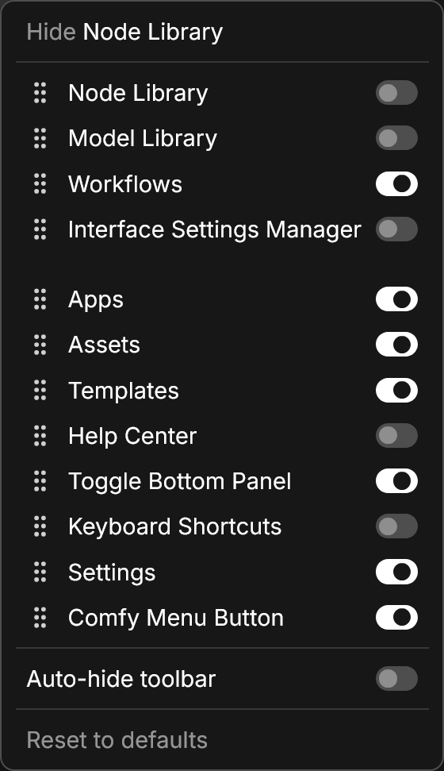

# ComfyUI Sidebar Hider

A ComfyUI frontend extension for hiding and rearranging icons in the left
sidebar toolbar.



Right-click the toolbar to hide, show, or reorder icons. Reset restores defaults. Optional auto-hide reveals the toolbar at the screen edge. Click outside or press `Esc` to close.
## Install

Copy this folder to your ComfyUI `custom_nodes` directory, for example:

```text
ComfyUI/custom_nodes/comfyui-sidebar-hider/
  __init__.py
  js/sidebarHider.js
```

Then restart ComfyUI (the backend must restart so it picks up the new
extension) and refresh the browser window.
